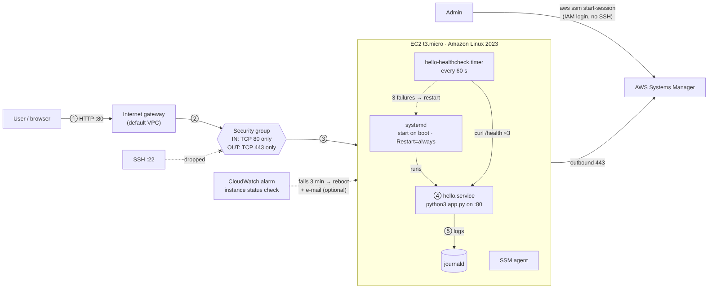
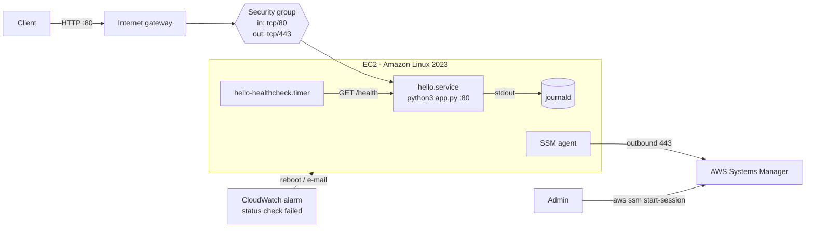

# hello-service

A small HTTP service plus the automation to run it on a Linux host: systemd
for start-on-boot and crash restarts, a health-check timer for hangs, a
CloudWatch alarm for instance failures, Terraform for an AWS Free Tier EC2
instance with no SSH, and GitHub Actions to validate all of it.

| Endpoint | Response |
|---|---|
| `GET /` | `Hello from hello-service!` |
| `GET /health` | `{"status": "ok", "service": "hello-service", "version": "1.0.0", "uptime_seconds": 42}` |
| `GET /metrics` | Prometheus text format: request counts by path and status, uptime |

> **Deployment status:** _fill in: "Deployed to AWS ap-south-1 on <date> and destroyed after testing" or "Not deployed; the hiring team confirmed code review is sufficient. Validated in CI."_

## Requirements → implementation

| Requirement | How |
|---|---|
| Small Linux instance, free tier | EC2 `t3.micro`/`t2.micro`, Amazon Linux 2023, default VPC |
| Starts after a restart | `hello.service` enabled under `multi-user.target` |
| Only the required public port | Security group allows inbound TCP 80 only; no port 22 rule, no key pair |
| Restricted admin access | SSM Session Manager only: IAM-authenticated, logged in CloudTrail, no inbound port |
| Detect unavailability, restart/report | App: `Restart=always` for crashes, `hello-healthcheck.timer` every 60 s for hangs (3 failed `/health` calls → error in journald + restart). Instance: CloudWatch alarm on `StatusCheckFailed_Instance` → reboot, optional e-mail via SNS |
| Script / Terraform | Terraform provisions AWS; cloud-init bootstraps the instance; `install.sh` installs on any systemd host; `deploy.sh` wraps Terraform |
| CI validates code + deployment check | Lint, unit tests, secret scan, real systemd install on the runner with crash/hang tests, `terraform validate` |
| No credentials in repo | Deploy uses local AWS CLI credentials; CI uses none; gitleaks scans every push |

## Architecture



Step-by-step walkthrough of every flow: [docs/PROJECT_FLOW.md](docs/PROJECT_FLOW.md)



**Request path**

1. The client connects to the instance's public IPv4 address on TCP 80.
2. The packet enters the default VPC through the internet gateway; the subnet route table delivers it to the instance's network interface.
3. The security group allows it (port 80 is the only inbound rule). Anything else, including port 22, is dropped. Return traffic is allowed because security groups are stateful.
4. The kernel passes the connection to `python3 /opt/hello-service/app.py` listening on `0.0.0.0:80`. systemd runs it as a dynamic non-root user that only has `CAP_NET_BIND_SERVICE`.
5. The app answers and logs the request to stdout, which journald stores.

**Admin path:** no inbound admin port. The SSM agent keeps an outbound HTTPS connection to Systems Manager; `aws ssm start-session` opens a shell over it, authorised by IAM.

**Health path:** every minute the timer runs `hello-healthcheck.sh` as root. It calls `http://127.0.0.1/health` (3 s timeout, 3 tries). If all fail it logs `UNHEALTHY` under the `hello-healthcheck` tag and restarts the service. If the whole OS stops responding, nothing on the box can run, so a CloudWatch alarm on the EC2 instance status check reboots it after 3 failed minutes and, if `alert_email` is set, sends an e-mail.

## Repository layout

```
app/app.py                  The service (Python standard library only)
tests/test_app.py           Unit tests
deploy/systemd/             hello.service, hello-healthcheck.service/.timer
deploy/healthcheck.sh       Health check: curl /health, restart on failure
terraform/                  Security group, IAM role for SSM, EC2, cloud-init, CloudWatch alarm
scripts/install.sh          Install on any systemd Linux host (used by CI)
scripts/deploy.sh           Terraform wrapper: preflight, plan, confirm, apply, smoke test
scripts/smoke-test.sh       External black-box test
.github/workflows/ci.yml    CI pipeline
operations-note.md          Outage runbook
docs/                       Diagrams and PROJECT_FLOW.md walkthrough
```

## Prerequisites

- Python 3.9+, `bash`, `curl` (Linux, macOS or WSL/Git Bash on Windows)
- For `install.sh`: a systemd Linux host (Ubuntu, Amazon Linux, a VM or WSL with systemd) and sudo
- For AWS: Terraform 1.6+, AWS CLI v2 with working credentials, the [Session Manager plugin](https://docs.aws.amazon.com/systems-manager/latest/userguide/session-manager-working-with-install-plugin.html), and an account on the Free Tier

## Setup

### 1. Run locally

```bash
python3 -m unittest discover -s tests -v
PORT=8080 python3 app/app.py
# second terminal
CHECK_SSH_CLOSED=false ./scripts/smoke-test.sh http://127.0.0.1:8080
```

### 2. Install on a Linux host

Installs the app, the units and the health check, enables them, then waits for `/health`. Safe to re-run.

```bash
sudo ./scripts/install.sh
```

### 3. Deploy to AWS

```bash
aws ec2 describe-instance-types --region ap-south-1 \
  --filters Name=free-tier-eligible,Values=true \
  --query "InstanceTypes[*].InstanceType" --output text   # pick a type from this list

cp terraform/terraform.tfvars.example terraform/terraform.tfvars   # optional
./scripts/deploy.sh --plan-only    # dry run, shows what would be created
./scripts/deploy.sh                # plan, confirm, apply, smoke test
```

The instance configures itself on first boot (cloud-init), so nothing connects to it during deploy. Changing the app or `app_version` and re-running replaces the instance; the public IP changes.

## Validation

```bash
URL=$(terraform -chdir=terraform output -raw service_url)
./scripts/smoke-test.sh "$URL"     # health, root, 404, metrics, port 22 closed
```

Security group has exactly one inbound rule:

```bash
aws ec2 describe-security-group-rules --region ap-south-1 \
  --filters Name=group-id,Values="$(terraform -chdir=terraform output -raw security_group_id)" \
  --query "SecurityGroupRules[?IsEgress==\`false\`].[IpProtocol,FromPort,ToPort,CidrIpv4]" --output table
```

Survives a reboot:

```bash
aws ec2 reboot-instances --region ap-south-1 --instance-ids "$(terraform -chdir=terraform output -raw instance_id)"
./scripts/smoke-test.sh "$URL"
```

Self-healing (in an SSM session, see `terraform output ssm_session_command`):

```bash
sudo systemctl kill -s SIGKILL hello.service    # crash: back within ~3 s
sudo systemctl kill -s SIGSTOP hello.service    # hang: timer restarts it within ~1-2 min
journalctl -t hello-healthcheck --since -5min
```

CI runs the same crash and hang tests on every push (`systemd-install` job).

## CI

| Job | What it checks |
|---|---|
| `lint` | ruff (Python), shellcheck (Bash) |
| `test` | Unit tests, then starts the app and runs the smoke test |
| `secret-scan` | gitleaks over the full git history |
| `systemd-install` | Runs `install.sh` on the runner (a real systemd VM) twice, verifies units, smoke tests, kills and freezes the service and checks it recovers |
| `terraform` | `fmt`, `init -backend=false`, `validate` (no AWS access needed) |
| `smoke-deployed` | Manual: **Actions → CI → Run workflow**, paste a URL to test a live deployment |

**Example run:** _add link / screenshot: ``_

## Cleanup

```bash
terraform -chdir=terraform destroy
aws ec2 describe-instances --region ap-south-1 \
  --filters Name=tag:Project,Values=hello-service Name=instance-state-name,Values=pending,running,stopping,stopped \
  --query "Reservations[].Instances[].InstanceId" --output text    # should print nothing
```

On a host set up with `install.sh`:

```bash
sudo systemctl disable --now hello.service hello-healthcheck.timer
sudo rm -rf /opt/hello-service /etc/hello-service /usr/local/bin/hello-healthcheck.sh \
  /etc/systemd/system/hello.service /etc/systemd/system/hello-healthcheck.*
sudo systemctl daemon-reload
```

## Troubleshooting

| Symptom | Likely cause | Check |
|---|---|---|
| `deploy.sh`: credentials not working | Missing/expired credentials | `aws sts get-caller-identity`; `aws configure` or `aws sso login` |
| `terraform plan`: no default VPC | Default VPC deleted | `aws ec2 create-default-vpc` |
| Instance type rejected / not free | Wrong type for account age or AZ | Run the free-tier query above |
| Smoke test times out just after deploy | Still booting | Wait 2 min; `aws ec2 get-console-output --instance-id <id> --latest` |
| Timeout later on | Instance replaced (new IP) or SG changed | `terraform output service_url`; check SG rules |
| Connection refused | Host up, app not listening | `systemctl status hello`; `journalctl -u hello -n 50`; `sudo ss -ltnp` |
| Health check keeps restarting the app | App starts but can't serve | `journalctl -u hello -t hello-healthcheck --since -15min`; `curl -v localhost/health` |
| `start-session`: TargetNotConnected | Agent not registered yet / no outbound 443 | Wait ~5 min; check egress rule and instance profile |
| `install.sh`: not running systemd | Container or WSL without systemd | Use a VM, or enable systemd in WSL |
| Alarm e-mails never arrive | SNS subscription not confirmed | Click the link in the AWS confirmation e-mail |
| Everything slow | CPU credits exhausted | CloudWatch `CPUCreditBalance` |
| Files missing on EC2 | cloud-init error | `sudo cat /var/log/cloud-init-output.log`; `cloud-init status --long` |

## Decisions and trade-offs

- **Python standard library, no framework.** Two endpoints don't need FastAPI. No dependencies means nothing to install on the host and nothing to patch.
- **systemd, not containers, on one VM.** systemd already gives boot start, restart, logging, resource limits and sandboxing. On ECS or Kubernetes the app would be packaged as an image and the platform's liveness probe would replace the timer.
- **cloud-init for EC2, `install.sh` for other hosts.** With no SSH on the instance, first-boot bootstrap is the simplest way to configure it. Both install the same files from `deploy/`, so they can't drift. At larger scale a configuration management tool such as Ansible would replace both.
- **Two levels of detection.** The timer covers the app; CloudWatch covers the instance, because a frozen OS can't run its own health check.
- **No SSH.** Session Manager is the tightest admin access AWS offers on one VM: no listening port, IAM-controlled, audited.
- **Two layers of recovery.** `Restart=always` can't see a hung process; the HTTP health check can.
- **Cost guardrails.** Instance type validation, one CloudWatch alarm (within the free 10), `cpu_credits = "standard"`, basic monitoring only, encrypted disk deleted on destroy.

## Assumptions and limitations

- **HTTP only.** TLS needs a domain and certificate (Caddy/nginx with Let's Encrypt, or an ALB with ACM, which isn't free).
- **Single instance, single AZ.** No redundancy. Production: Auto Scaling group behind an ALB, ALB health checks replacing the local timer.
- **Public IP changes** on replacement or stop/start; an Elastic IP or DNS record would fix that.
- **App failures are reported locally** (journald + `/metrics`); only instance failures alert by e-mail. Production would ship logs with the CloudWatch agent, scrape `/metrics` with Prometheus, and alert on app errors too.
- **Local Terraform state.** A team would use S3 with state locking.
- **Egress 443 to anywhere.** Needed for SSM over the internet gateway. VPC endpoints in a private subnet would remove that.
- **Liveness only.** `/health` proves the process serves HTTP; a service with dependencies would add a readiness check.
- **Free Tier depends on the account.** Public IPv4 addresses are billed outside free allowances; destroy when done.

## How this was built

_Edit in your own words. Suggested: "I used an AI assistant (Claude) to help draft and review parts of the code and documentation. I chose the approach, ran and tested everything locally and in CI, and can explain each part."_
