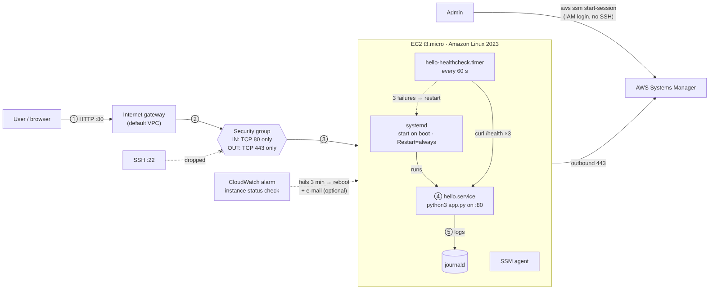
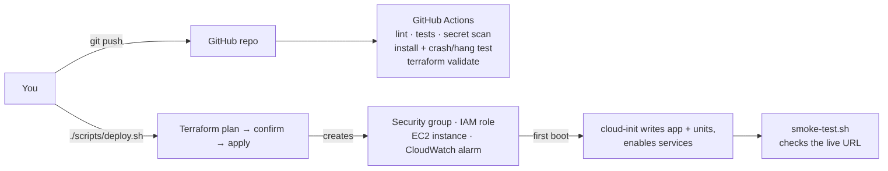

# Project flow: what hello-service implements

## The goal in one paragraph

Run a tiny web service on a free AWS Linux server so that it **answers on one
public port only**, **starts by itself after a reboot**, **repairs itself when it
crashes or hangs**, and **can be managed without SSH**. Everything is created by
code (Terraform), checked automatically on every push (GitHub Actions), and
documented so another engineer can operate it (README + operations note).

## The five flows

### 1. Request flow: a user opens the URL



1. Browser sends `GET http://<public-ip>/` on **TCP 80**.
2. Traffic enters the AWS **default VPC** through the **internet gateway**.
3. The **security group** checks it. Port 80 is the only inbound rule, so it
   passes. Port 22 (SSH) or anything else is dropped.
4. On the server, **systemd** keeps `python3 /opt/hello-service/app.py` running
   on port 80 as a non-root user. The app returns `Hello from hello-service!`
   (or JSON on `/health`, counters on `/metrics`).
5. The app writes one log line to stdout, which **journald** stores
   (`journalctl -u hello`).

### 2. Self-healing flow: something breaks

| What breaks | Who notices | What happens |
|---|---|---|
| App process crashes | systemd (`Restart=always`) | Restarted after 3 s |
| App hangs (running but not answering) | `hello-healthcheck.timer`, every 60 s | `healthcheck.sh` calls `/health` 3 times; all fail → logs `UNHEALTHY`, runs `systemctl restart hello` |
| Whole OS frozen | CloudWatch alarm on `StatusCheckFailed_Instance` | After 3 failed minutes, AWS reboots the instance (and e-mails if `alert_email` is set) |
| Server rebooted | systemd (`WantedBy=multi-user.target`) | Service and timer start automatically on boot |

### 3. Admin flow: an engineer needs a shell

No SSH port, no key pair. The **SSM agent** on the server keeps an outbound
HTTPS (443) connection to **AWS Systems Manager**. The admin runs
`aws ssm start-session --target <instance-id>`; AWS checks their IAM
permissions and relays the shell. Every session is logged in CloudTrail.

### 4. Deploy flow: going from code to a running server



1. `./scripts/deploy.sh` checks that `terraform`, `aws` and `curl` exist and that
   AWS credentials work.
2. `terraform plan` shows what will be created; you confirm with `y`
   (`--plan-only` stops here, a dry run).
3. `terraform apply` creates: security group + rules, IAM role + instance
   profile, EC2 instance, CloudWatch alarm (+ SNS topic if e-mail is set).
4. Terraform packs `app.py`, the systemd units and `healthcheck.sh` into the
   instance's **user_data**. On first boot, **cloud-init** writes them to disk and
   enables the services. Nothing connects to the server.
5. `smoke-test.sh` waits for `/health` on the public IP and checks every endpoint
   and that port 22 is closed.
6. Cleanup: `terraform destroy` removes everything.

### 5. CI flow: every `git push`

| Job | Checks |
|---|---|
| `lint` | ruff on Python, shellcheck on Bash |
| `test` | 8 unit tests; starts the app and runs `smoke-test.sh` |
| `secret-scan` | gitleaks: no keys or passwords anywhere in git history |
| `systemd-install` | Runs `install.sh` on the runner (a real Linux VM), twice; verifies units; smoke test; kills the app (crash test) and freezes it (hang test) and proves it recovers |
| `terraform` | `fmt`, `init -backend=false`, `validate`, with no AWS credentials needed |
| `smoke-deployed` | Manual only: paste a live URL, it runs the smoke test against it |

## How the files connect

```
app/app.py ─────────────┬─> tests/test_app.py        (imports and tests it)
                        ├─> deploy/systemd/hello.service (ExecStart runs it)
                        └─> terraform/main.tf         (packed into user_data)

deploy/systemd/hello.service ─────────┐
deploy/healthcheck.sh ────────────────┤
deploy/systemd/hello-healthcheck.service (runs healthcheck.sh)
deploy/systemd/hello-healthcheck.timer   (triggers the .service above)
                                      │
            ┌─────────────────────────┴──────────────┐
            v                                        v
terraform/main.tf + cloud-init.yaml.tftpl     scripts/install.sh
  (EC2: written on first boot)                 (any Linux host / CI runner)

terraform/variables.tf ─> main.tf, cloudwatch.tf ─> outputs.tf
terraform/versions.tf   (provider for all .tf files)
terraform.tfvars.example ─> your terraform.tfvars ─> variables.tf

scripts/deploy.sh ─> terraform/ ─> outputs.tf (service_url) ─> scripts/smoke-test.sh

.github/workflows/ci.yml ─> tests/, scripts/install.sh, scripts/smoke-test.sh,
                            deploy/, terraform/, ruff.toml
```

## Tech stack and why

| Layer | Tool | Why this one |
|---|---|---|
| App | Python standard library | 3 endpoints need no framework; nothing to install on the server |
| Process manager | systemd | Built into Linux: boot start, restart, logs, sandbox, memory limit |
| Health check | Bash + systemd timer | Catches hangs that `Restart=always` can't see |
| Cloud | AWS EC2 Free Tier | Free; Session Manager gives admin access with no SSH at all |
| Infrastructure as code | Terraform | One `apply` creates everything, one `destroy` removes everything |
| Server bootstrap | cloud-init | Configures the server on first boot without connecting to it |
| Monitoring | CloudWatch alarm (+ SNS) | Detects a frozen OS, which nothing on the box can detect |
| CI | GitHub Actions | Validates code and config on every push without cloud credentials |
